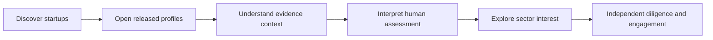
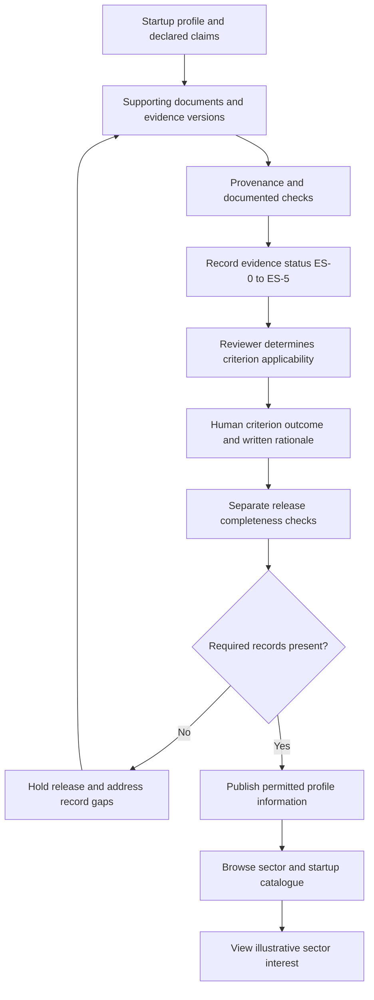
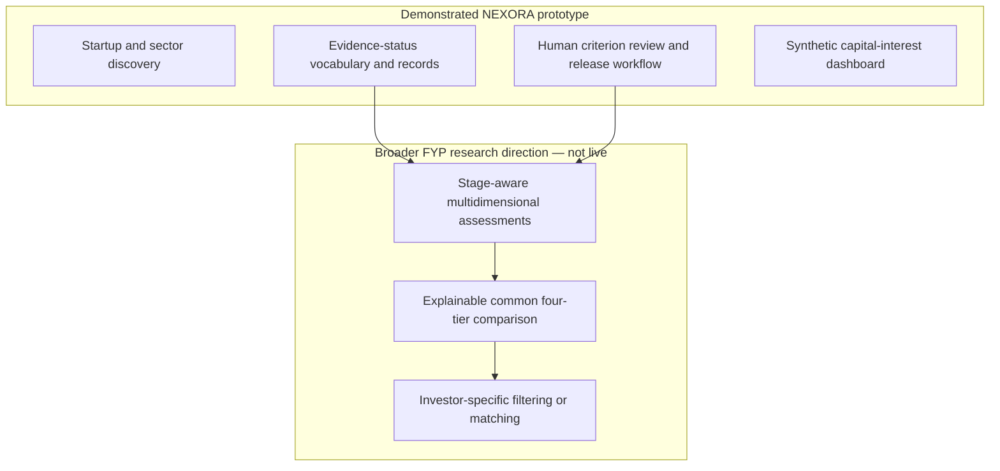

NEXORA
PRIVATE CAPITAL INTELLIGENCE
An evidence-led discovery and research platform for Pakistan's private startup ecosystem.

Discover businesses. Examine the evidence. Understand assessments. Explore capital interest.

Final Year Project Prototype · BS Financial Technology · FAST–NUCES, Islamabad

Research project: A Multi-Tier Framework for Startup Evaluation and Capital Access

Explore the Platform · Features · End-to-End Workflow · Evidence Methodology · Data · Run Locally · Research Roadmap

[!IMPORTANT]
Academic, synthetic-data prototype. The companies, activity, investor-interest signals, and statistics depicted here are illustrative—not live Pakistani market data. NEXORA's currently demonstrated functions must not be confused with the proposed four-tier investment-opportunity evaluation framework. Tier calculations, automated financial scores, and actual investment transactions are not operational features of the demonstrated prototype.

01 · Executive Summary
NEXORA (Private Capital Intelligence) is a Pakistan-focused final-year-project prototype designed to make fragmented startup information more discoverable, organized, traceable, and interpretable. It brings together released business profiles, sector-level navigation, evidence-status records, human criterion assessment, publication controls, and an illustrative picture of investor interest.

Many early-stage businesses are difficult to compare: claims may be presented without supporting documents; evidence may have different degrees of completeness; verification may depend on an institution's access and the founder's consent; and capital providers may not have a consistent account of why a criterion was judged met or unmet. NEXORA studies a structured way to handle those differences, without presenting a document upload or a database status as an automatic investment endorsement.

The interface communicates a simple research sequence:

Discover → Understand evidence → Evaluate transparently → Navigate capital opportunities
At a glance
Item	Description
Platform name	NEXORA
Positioning	Private Capital Intelligence
Primary geography	Pakistan
Project type	Academic FYP / applied research prototype
Research foundation	A Multi-Tier Framework for Startup Evaluation and Capital Access
Core approach	Evidence-oriented records and reasoned, human-led assessment
Public experience	Startup discovery, sector directory, methodology transparency, capital-interest overview
Demonstration dataset	Synthetic startup and investor-activity records
Not implemented as an operational feature	Four-tier assignments, automated investment scores, funding execution

02 · The Problem NEXORA Addresses
Information asymmetry: Founders, startup evaluators, investors, and institutions may not see the same information or interpret the reliability of available evidence in the same way.

Fragmented discovery: Startup information is dispersed across sectors, geographies, and development stages, complicating structured exploration.

Unclear verification: A submitted document, a check of a limited official record, and an independently validated business claim are different things; combining them under one vague “verified” label risks overstating certainty.

Opaque judgments: Business assessments can be hard to understand when the criterion, referenced evidence, outcome, and reviewer rationale are not recorded together.

Capital-signal ambiguity: An expression of interest is not the same as an investment decision, a signed commitment, a source of available funding, or a completed transaction.
Project objectives
1. Improve startup discovery through consistent released profiles and sector-based navigation.
2. Organize supporting evidence while preserving status, provenance, and the limits of documented checks.
3. Support explainable evaluation with reviewer-entered criterion outcomes and reasons, separate from evidence status.
4. Provide controlled publication using release checks and access to designated evidence versions.
5. Visualize illustrative capital interest without implying investment commitment or funding availability.
6. Provide a practical research foundation for future stage-aware, multidimensional, four-tier comparative evaluation.
03 · Platform Tour & Screenshots
All six screenshots below are included in this repository's companion screenshot folder and use relative Markdown paths, so they display directly in GitHub when the folder structure is preserved.
3.1 Landing page — Pakistan's private-market intelligence

What is visible
- Brand identity: NEXORA — Private Capital Intelligence.
- Main headline: “The Intelligence Layer for Private Capital.”
- Positioning: discovery of emerging businesses, understanding the evidence behind profiles, and navigating Pakistan's evolving startup ecosystem.
- Illustrative network graphic: an outlined map of Pakistan with named locations Islamabad, Lahore, Multan, Quetta, and Karachi. The illustration does not establish actual coverage or validated startup counts for these cities.
- Primary calls to action: Explore Startups and Join the Ecosystem.
- Top navigation shown: Discover, Sectors, How It Works, Capital Intelligence, About, Sign In, and Request Access.
- Ecosystem snapshot: released startups, sectors represented, criterion records, and interest signals, labeled as synthetic demonstration data.
Why this page exists: it introduces the platform's purpose and offers entry points into discovery, research methodology, and access-related navigation. The presence of Sign In or Request Access in the UI alone does not establish particular account privileges or authentication mechanisms.
3.2 Featured startups & sector exploration

The homepage contains two complementary browsing sections.

Featured startups
Demo startup	Sector	Location	Stage label shown	Profile description shown
Raastwell Labs	FinTech	Karachi	Early traction	Reconciliation infrastructure for independent retailers and payment service providers
MittiSpan Systems	AgriTech	Multan	Pilot	Irrigation monitoring and water-use reporting for grower cooperatives
HelioKaar Energy	ClimateTech	Lahore	Early traction	Solar asset monitoring and performance analytics for commercial rooftops

Each visible card presents initials/avatar, sector, name, stage badge, concise description, city/country, and a “View profile” entry point. The section includes View full catalogue.

Explore the ecosystem displays preview cards for FinTech, EdTech, Artificial Intelligence, and HealthTech, each with a short sub-sector description, a count of released profiles, and an Explore sector action. The View all sectors action leads into the wider directory concept.
Reading the cards correctly: “Pilot” and “Early traction” are development-stage descriptors, not investment scores or NEXORA tier assignments. The featured organizations are synthetic demonstration examples.

3.3 How NEXORA works — user-facing research workflow

The public page presents four stages:
Step	Label on platform	Intended action	Visible explanation
01	Discover businesses	Browse published business profiles	Explore by sector, location, and development stage
02	Understand evidence	Examine supporting records and documented checks	Understand claims, file provenance, and evidence context
03	Evaluate transparently	Record review findings	Human criterion judgments are entered with reasons
04	Navigate capital opportunities	Explore interest trends	View recorded expressions of interest across sectors

Other visible entry points are Read the methodology, View Capital Landscape, and Contact the team for institutional research inquiries. These describe interface destinations and the platform's workflow; they should not be read as proof of automated execution, live deal matching, or a functioning messaging back end.
3.4 Sector directory — structured ecosystem browsing

The directory displays ten sectors, their topical subareas, a released-profile count, and Explore sector navigation:
Sector	Subareas listed in the interface
FinTech	Payments · Embedded finance · SME finance
EdTech	Skills development · Digital classrooms · Assessment
Artificial Intelligence	Applied AI · Language technology · Data infrastructure
HealthTech	Care delivery · Diagnostics · Clinical operations
AgriTech	Farm management · Supply chains · Precision agriculture
ClimateTech	Clean energy · Adaptation · Circular economy
SaaS and Enterprise Technology	Workflow software · Operations · Enterprise infrastructure
E-commerce and RetailTech	Commerce enablement · Retail analytics · Marketplaces
Logistics and Mobility	Last-mile delivery · Fleet operations · Freight
DeepTech and Emerging Technologies	Robotics · Advanced materials · Industrial sensing

Snapshot: the screenshot displays one released profile per sector, for a total of ten synthetic released profiles. This is a sample taxonomy, not an official or exhaustive classification of Pakistan's startup ecosystem.
3.5 Research methodology — evidence, human assessment & controls

The Evidence and human assessment page is an important transparency component. It explicitly communicates:
- Evidence status vocabulary with codes ES-0 through ES-5 (transcribed in Section 06).
- Criterion assessment: a human reviewer records applicability, linked evidence, a descriptive outcome, and reasoning; evidence status never determines the criterion result by itself.
- Pakistan verification context: FYP research examined 23 verification routes across six access classes; available checks depend on institution, source, and consent.
- Release and limitations: a separate release officer checks for required records; founders may allow access to specific evidence versions; tier rules, financial scores, and investment transactions are outside the operational prototype.
This page makes the platform's claims and boundaries inspectable rather than merely presenting an opaque “startup rating.”
3.6 Capital Landscape — sector-level interest intelligence

The dashboard presents 14 interest signals across 9 sectors with activity, with bars for each sector. FinTech and ClimateTech show three records each, AgriTech two, six other sectors one each, and DeepTech and Emerging Technologies zero. The page says these records are from synthetic investors, and specifically states that they do not convey capital commitment or funding availability.

A bar represents recorded illustrative activity, not money raised, investor demand measured in rupees, probability of funding, a conversion rate, verified investment appetite, or an offer to invest.
04 · Platform Capabilities
The following table distinguishes what is visible in the provided UI, what is described in the prototype's methodology, and what remains outside demonstrated operational scope.
Area	Capability or behavior	Evidence in supplied screens	Scope
Navigation	Discover / Sectors / How It Works / Capital Intelligence / About	Header and landing page	Visible UI
Access entry points	Sign In, Request Access, Join the Ecosystem	Header and hero	Visible UI; backend behavior not verified
Startup catalogue	Released startup cards and profile links	Featured Startups	Visible UI
Structured summaries	Sector, location, stage, startup description	Featured Startups	Visible UI
Sector taxonomy	10 sectors, subareas, per-sector released-profile counts	Sector directory	Visible UI
Research transparency	Evidence-status codebook and explanatory sections	Methodology	Visible UI
Provenance/check records	Claims, provenance, documented checks	How It Works / Methodology	Described workflow
Criterion review	Applicability, linked evidence, reviewer outcome and rationale	Methodology	Described workflow
Publication controls	Separate release officer; checks for required records	Methodology	Described workflow
Evidence permissioning	Founder access grants for specific evidence versions	Methodology	Described workflow
Sector interest visualization	Sector bars and recorded signal counts	Capital Landscape	Visible UI — synthetic
Institutional contact	Contact the team	How It Works	Visible UI; submission behavior not verified
Comparative four-tier assignment	Tier 1–4 classification	Research vision only	Not operational in shown prototype
Automated investment scoring	Machine-produced investment or financial scores	Explicitly excluded by methodology	Not operational in shown prototype
Investment execution	Funding, transfers, settlement, or closing transactions	Explicitly excluded by methodology	Not operational in shown prototype

Example audience journeys
Founder / startup representative
1. Prepare a clear profile containing business claims, development stage, sector, and location.
2. Supply supporting evidence where applicable and identify which versions may be accessed.
3. Allow permitted checks and respond to evidence gaps.
4. Understand that completing documentation does not guarantee a favorable assessment or capital access.
Human reviewer / research assessor
1. Select the relevant criterion and determine whether it applies at the startup's stage.
2. Inspect the available evidence and its provenance or verification context.
3. Record the criterion outcome and the reason for that judgment separately from the evidence-status code.
4. Flag uncertainty, missing evidence, limitations, or critical concerns as appropriate.
Release / governance reviewer
1. Check for the presence of the records required for a profile to be published.
2. Respect any founder-granted permission and evidence-version restrictions.
3. Treat release eligibility as a publication control—not a certification of investment quality.
Startup explorer / prospective investor
1. Discover released businesses through the catalogue or sector directory.
2. Read visible business descriptions and distinguish development stage from quality.
3. Consult the methodology to understand what evidence statuses and assessments mean.
4. Review the capital landscape as illustrative sector activity only and undertake separate due diligence before any real decision.
These are intended/research-level journeys derived from the interface wording; the screenshots alone do not verify a complete live role-permission implementation.
05 · End-to-End Workflow
5.1 Simplified public-facing journey

5.2 Evidence-to-publication research workflow

Interpretation: This diagram synthesizes the research workflow communicated in the screenshots. It is not a verified internal implementation diagram, database schema, security model, API contract, or evidence that every step is automated.
5.3 Three distinctions the platform preserves
Concept	What it means	What it does not prove
Evidence status	The state of submitted/available evidence for a criterion	Criterion satisfaction or investment attractiveness by itself
Criterion outcome	A human reviewer judgment, with applicability and rationale	Automatic funding approval or risk-free investment
Profile release	Required publication records have been checked	Financial soundness, valuation, audit assurance, or regulatory endorsement

06 · Evidence and Assessment Methodology
6.1 Evidence-status vocabulary — as displayed
Code	Label / meaning on methodology page	Practical interpretation
ES-0	Not yet assessed	The evidence position has not yet been evaluated
ES-1	Evidence demonstrates the criterion is not met	The reviewed evidence indicates a criterion is not satisfied
ES-2	Evidence supplied but insufficient	Material exists, but it does not adequately support the criterion
ES-3	Evidence not provided	Required or expected material has not been submitted
ES-4	Unavailable through current verification route	The attempted/available route cannot supply the needed check
ES-5	Inapplicable to the startup stage	This criterion is not relevant to the startup at its present stage

[!CAUTION]
Do not turn ES codes directly into numerical merit scores. The labels are categorical descriptions of evidence circumstances. For example, “not provided” and “unavailable through the current verification route” communicate different reasons for a gap; “inapplicable” must not be treated as failure simply because it is not verified.

6.2 Human-led criterion review
The methodology screen describes an assessment record composed of:
- Applicability — does the criterion apply to this business and development stage?
- Linked evidence — which submitted records or versions support consideration of the criterion?
- Descriptive outcome — the assessor's finding on the criterion.
- Reasoning — the explanation supporting that conclusion.
The page explicitly states that evidence status never determines criterion results. Financial sustainability, risk, due diligence, and investment attractiveness remain human-led judgments in the demonstrated approach.
6.3 Verification in Pakistan: precise scope
The FYP methodology screen reports analysis of 23 verification routes spanning six access classes. The exact list of routes and class definitions are not shown in the screenshots, so they are not invented here. The platform's text stresses that source access can depend on institution, data source, and consent.

A return-filing record, for instance, can support a narrow statement about filing status. It does not independently validate all financial statements, operational metrics, management claims, or future investment prospects.

Prototype position: records of manual checks and submitted materials; not a claim that the application has automated authorization or integration with every public, private, or regulated verification source.
6.4 Data release and consent boundaries
The methodology describes a separate release officer checking for the presence of required records. It also describes founders granting access to specific evidence versions. These concepts help prevent mixing (a) evidence collection, (b) human assessment, (c) authorization to view material, and (d) publication readiness into one decision.

Not confirmed from the screenshots: specific encryption methods, role-permission rules, audit-log structures, login providers, hosting environment, and data retention policies. These need repository or implementation evidence before technical claims are added.
07 · Demonstration Data
7.1 Homepage ecosystem snapshot
Metric shown	Value	Interpretation
Released startups	10	Synthetic profiles made visible in the demo
Sectors represented	10	Categories represented by the demonstration catalogue
Criterion records	10	Recorded criterion entries shown by the demo snapshot
Interest signals	14	Synthetic investor-interest activity records
Sectors with activity	9	Sector categories with one or more displayed signals

Source: the provided NEXORA homepage, directory, and Capital Landscape screenshots taken in November 2026. Values are demonstration-state observations, not live market statistics.
7.2 Capital Landscape — recorded interest by sector
Sector	Synthetic interest signals	Share of all 14 signals
FinTech	3	21.4%
ClimateTech	3	21.4%
AgriTech	2	14.3%
EdTech	1	7.1%
Artificial Intelligence	1	7.1%
HealthTech	1	7.1%
SaaS and Enterprise Technology	1	7.1%
E-commerce and RetailTech	1	7.1%
Logistics and Mobility	1	7.1%
DeepTech and Emerging Technologies	0	0.0%
Total	14	100%

Percentages are derived from the visible demonstration counts and rounded to one decimal place; the displayed percentages may not add to 100.0% due to rounding.

Interpretation example: Three interest signals in FinTech indicate three recorded illustrative signal entries in the demo. They do not imply three unique real investors, three deals, any committed amount, or an investment success rate.
7.3 What can and cannot be concluded
Can conclude from the provided screens: NEXORA presents a ten-sector taxonomy; displays released startup examples; communicates evidence and review methodology; and visualizes a synthetic 14-signal distribution.

Cannot conclude from these screens: that the data came from actual Pakistani startups or institutional investors; that all links/forms are fully connected; that every described review process is implemented end to end; or that users can receive, send, or invest real money through the platform.
08 · Broader FYP Research: The Four-Tier Framework
The research underpinning NEXORA is A Multi-Tier Framework for Startup Evaluation and Capital Access. Its long-term goal is to provide a common comparative pool of private startup opportunities in which the four tiers summarize relative, multidimensional opportunity strength—rather than simply age, revenue, maturity, a document-completeness percentage, or a single investor's preferences.
Research-level evaluation dimensions
Dimension	Research question
Opportunity and market	Is the problem meaningful and the potential market credible?
Idea and feasibility	Is the proposed solution technically and operationally plausible?
Founder and team	Does the team have relevant capabilities and execution capacity?
Commercial and financial case	Is the revenue model/economic case coherent and supportable for its stage?
Execution and validation	Is there credible progress, testing, or market evidence appropriate to the stage?
Governance and risk	Are material risks, controls, transparency, and unresolved weaknesses understood?

The framework's research direction emphasizes stage-appropriate evidence, explainable rules, transparent uncertainty, and critical-risk consideration. A stronger tier should reflect the overall relative strength of an opportunity, not merely the volume of uploaded evidence. Investor-specific matching or preferences would be an additional, separate layer rather than the definition of the common tier.
How this relates to NEXORA today

Current boundary: The prototype methodology specifically says “Tier rules, financial scores and investment transactions are outside the operational prototype.” This is a research roadmap, not a live four-tier recommendation engine.

09 · Screens, Routes & Navigation Inventory
The following lists visible page names and actions. Exact URL paths, authentication behavior, and component names are not verifiable from screenshots alone.
Screen or area	Visible actions / components	Purpose
Header	Discover · Sectors · How It Works · Capital Intelligence · About	Main site navigation
Header access area	Sign In · Request Access	Account/access entry points shown
Home hero	Explore Startups · Join the Ecosystem	Discovery and ecosystem entry points
Ecosystem snapshot	Four high-level counters	Quick synthetic dataset summary
Featured Startups	View profile · View full catalogue	Startup discovery entry points
Explore the ecosystem	Explore sector · View all sectors	Preview and browse taxonomy
How NEXORA works	Read the methodology	Explain research process
Capital intelligence card	View Capital Landscape	Open sector interest view
Institutional inquiries card	Contact the team	Research and collaboration entry point
Sector directory	Explore sector on each of 10 cards	Sector-specific exploration
Methodology page	Evidence vocabulary · Criterion assessment · Verification context · Release and limitations	Explain evidence and human review
Capital Landscape	14 interest signals · 9 active sectors · sector bars	View synthetic activity
Footer	About · Contact · Privacy · Terms	Informational navigation shown

10 · Getting Started
10.1 Obtain the source
If you have access to the project's GitHub repository:
# Replace this with your actual repository address.
git clone https://github.com/<YOUR-USERNAME>/<YOUR-NEXORA-REPOSITORY>.git
cd <YOUR-NEXORA-REPOSITORY>
Or download the repository ZIP from GitHub (Code → Download ZIP), extract it, and open the extracted directory in VS Code.
10.2 Identify the actual application setup
The images establish the design and displayed functionality, not the technology stack. Do not assume React, Next.js, Express, Django, MongoDB, PostgreSQL, or specific run commands solely from this README.
1. Open the project root and inspect its existing setup instructions.
2. If a package.json is present, inspect its scripts and dependencies and use the project's documented package manager.
3. If a Python/backend project is present, follow that project's dependency and run instructions.
4. Create configuration files only as indicated by an existing .env.example or trusted project documentation.
5. Start the application and use the localhost address reported by its development server.
Why no hard-coded install command? The source repository and its manifest files were not included with the six screens. Adding unverified commands would make the README look complete while potentially causing installation failures. Once package.json, a lockfile, and any backend instructions are checked, this section should be replaced with exact, tested commands.
10.3 Preview the documentation in VS Code
Open the folder containing README.md, select the file, and press Ctrl + Shift + V to render the Markdown preview. The Mermaid diagrams and images also render on GitHub.
11 · Repository Documentation & Screenshot Assets
To display all screenshots correctly in GitHub, use this exact relative structure:
<your-nexora-repository>/
├── README.md
├── assets/
│   └── screenshots/
│       ├── 01-home-hero.jpg
│       ├── 02-startups-and-sectors.jpg
│       ├── 03-workflow.jpg
│       ├── 04-sector-directory.jpg
│       ├── 05-methodology.jpg
│       └── 06-capital-landscape.jpg
└── [your existing application files and folders]
Upload via GitHub website (no terminal required)
1. Open the actual NEXORA GitHub repository.
2. If README.md exists, open it and click Edit (pencil icon); otherwise select Add file → Create new file, name it README.md, and paste the complete Markdown content.
3. Select Commit changes.
4. In the repository, open or create the folder path assets/screenshots/ (GitHub supports paths when naming new files), then use Add file → Upload files to upload all six image files from this package.
5. Commit those files; refresh the repository's main page and ensure each screenshot appears.
Important: Uploading only README.md will leave broken image links. Upload the accompanying assets/screenshots directory as well. If your repository already has an assets folder, merge the screenshot folder into it rather than overwriting other files.

Source changes vs. documentation changes
This README documents the supplied UI and research concept. Adding it to GitHub does not change the running application or create capabilities such as user roles, evidence storage, login, investor matchmaking, or tier assignment.
12 · Responsible Research, Privacy & Limitations
NEXORA is not an exchange, crowdfunding portal, broker, registered investment advisor, official government verification service, or a guarantee of access to capital. The demonstrated dashboard does not represent real-world capital availability.
- Synthetic demonstration only. The displayed company names and activity counts do not establish real-world company facts or transactions.
- Evidence ≠ criterion satisfaction. A document may be present but insufficient; a limited check may confirm only a limited fact.
- Criterion satisfaction ≠ investor approval. Risk, sustainability, suitability, governance, and financing judgments require appropriate human review.
- Profile release ≠ audited verification. A release check on required records is not a financial audit or an assurance opinion.
- Interest signal ≠ committed capital. A count of synthetic sector signals is not a funding offer.
- Consent and access matter. Sensitive business documents require appropriately authorized handling; the screenshot alone does not establish security controls.
- No operational tiering or investment execution. The proposed four-tier framework and live financial transactions are outside the operational prototype.
- No verified technical stack or deployment URL. Architecture, API endpoints, hosting, test coverage, licenses, and environment variables should be documented only after examining the actual source.
For real-world deployment, additional requirements would include appropriate legal and regulatory review, authentication and authorization, privacy and retention controls, secure evidence handling, auditability, and validation of assessment methodology. These are future considerations, not claimed existing implementations.
13 · Research Roadmap
The following items are future research and engineering directions, not promises or completed capabilities.
- [ ] Verify and document the repository's actual languages, frameworks, dependencies, and local setup.
- [ ] Document true routes, data models, access-control behavior, and review permissions from implementation.
- [ ] Validate criterion taxonomies and stage-aware evaluation rules against research cases.
- [ ] Formalize an interpretable, common four-tier comparative opportunity framework.
- [ ] Explicitly model uncertainty, evidence insufficiency, inapplicability, and critical weaknesses.
- [ ] Keep common tiers conceptually separate from investor-specific interests and matching.
- [ ] Test reviewer consistency, record traceability, usability, and methodological fairness.
- [ ] Explore authorized external verification integration only where lawful and technically viable.
- [ ] Evaluate the approach with appropriately approved synthetic or anonymized records.
- [ ] Publish documented test results and reproducible evaluation criteria.
14 · Academic Attribution
Field	Details
Product / prototype	NEXORA — Private Capital Intelligence
FYP research	A Multi-Tier Framework for Startup Evaluation and Capital Access
Degree program	BS Financial Technology
Institution	FAST–NUCES, Islamabad, Pakistan
Project category	Final Year Project / research and development prototype
Demonstration geography	Pakistan
Data declaration	Synthetic / illustrative, as labeled in the UI

Contributors, supervisor, source-code license, and repository link should be inserted from confirmed project records rather than guessed.

NEXORA · PRIVATE CAPITAL INTELLIGENCE
Structure the information. Preserve the evidence. Explain the judgment.

Academic prototype for Pakistan's startup and private-capital research ecosystem.

