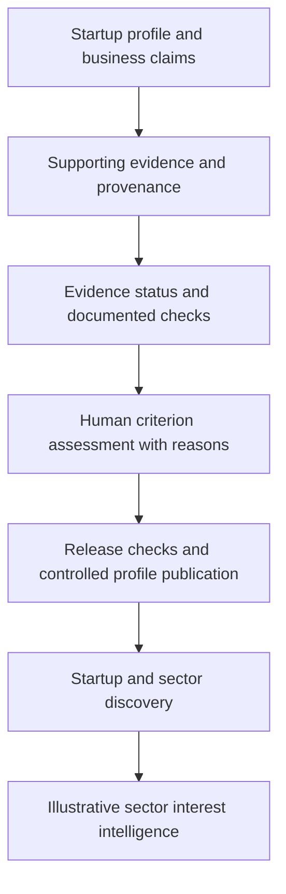

NEXORA
Private Capital Intelligence
An evidence-led startup discovery and private-market intelligence prototype for Pakistan.

Final Year Project — BS Financial Technology | FAST–NUCES, Islamabad

Research foundation: A Multi-Tier Framework for Startup Evaluation and Capital Access

Overview · Features · Screenshots · Methodology · Getting Started · Limitations

Overview
NEXORA is a Pakistan-focused prototype that brings together startup discovery, structured evidence records, human-led criterion assessment, and illustrative capital-interest intelligence in one interface. It explores how clearer information about private businesses may help founders, reviewers, researchers, and prospective capital providers navigate an ecosystem where startup information is often fragmented, difficult to compare, or hard to verify.

The prototype is associated with the FYP research project “A Multi-Tier Framework for Startup Evaluation and Capital Access.” The broader research investigates a transparent, multi-dimensional approach to comparing startup investment opportunities, while the currently demonstrated application implements a narrower set of evidence, assessment, discovery, and release workflows.
Academic demonstration: All companies and recorded activities shown in the provided prototype screenshots are synthetic. Investor interest signals are illustrative and do not indicate funding availability, investment commitments, due diligence completion, or investment recommendations.

Problem Statement
Startups and SMEs in Pakistan can face information asymmetry when engaging potential financiers. Business claims, supporting documents, review outcomes, and market information may be scattered across disconnected sources. Investors and institutions may therefore find it difficult to discover relevant opportunities or interpret the basis of a business's claims consistently.

NEXORA explores a structured alternative: make profiles discoverable, distinguish claims from their supporting evidence, preserve human judgment and rationale, and present market-level interest indicators without presenting them as verified funding offers.
Project Objectives
- Organize discoverable startup profiles by sector, location, and development stage.
- Make supporting evidence and its status easier to understand and trace.
- Record human criterion assessments, including explanations and references to evidence.
- Support controlled release of startup profiles and consent-based access to evidence versions.
- Demonstrate sector-level private-capital interest indicators using synthetic data.
- Establish a research foundation for an explainable, multi-tier assessment framework, without implying that tier generation has already been implemented in this prototype.
Platform Preview
1. Homepage — Private Capital Intelligence

The landing page introduces NEXORA's research-driven private-market intelligence concept, startup discovery entry points, and an illustrative map of Pakistan's startup ecosystem.
2. Featured Startups and Sector Exploration

Explore released profiles through startup cards that summarize a business's sector, location, development stage, and description. The homepage also offers direct navigation into prominent sectors.
3. Research Workflow

The platform communicates four user-facing activities: discover businesses → understand evidence → evaluate transparently → navigate capital opportunities.
4. Sector Directory

A sector-focused directory presents categories and their illustrative subareas to help users browse the ecosystem.
5. Research Methodology and Evidence Assessment

The methodology page distinguishes evidence status from the separate human assessment of business criteria, and communicates the scope and limits of the prototype.
6. Capital Landscape

A sector-level dashboard visualizes recorded synthetic interest signals. These are activity indicators, not evidence that an investor has committed capital.
Key Features
Module	What it demonstrates
Startup Discovery	Browse released company profiles and explore businesses by sector, location, and stage.
Sector Intelligence	Review ten sector categories and their subareas.
Evidence Records	Distinguish submitted claims, file provenance, documented checks, and evidence status.
Human Assessment	Record criterion-level judgments, applicability, linked evidence, outcomes, and reasons.
Profile Release	Separate release checks from ordinary evaluation and record the presence of required documentation.
Capital Intelligence	Summarize illustrative investor-interest records by sector without implying financing availability.
Research Transparency	Explain verification context, assessment principles, and prototype boundaries.

Sectors Represented
The demonstration directory includes:
1. FinTech
2. EdTech
3. Artificial Intelligence
4. HealthTech
5. AgriTech
6. ClimateTech
7. SaaS and Enterprise Technology
8. E-commerce and RetailTech
9. Logistics and Mobility
10. DeepTech and Emerging Technologies
Demonstration Dataset
The screenshots show the following synthetic prototype snapshot:
Indicator	Recorded value
Released startup profiles	10
Sectors represented	10
Criterion records	10
Investor-interest signals	14
Sectors with recorded interest activity	9

These figures are from the supplied screenshots, not live ecosystem statistics. They may change as demonstration data is updated.
Research Methodology
NEXORA is informed by a design-science / applied system-development approach: understand a real information problem, design a structured workflow, implement a demonstrable artifact, and examine how the artifact addresses the problem within its documented constraints.
Evidence-Status Vocabulary
The methodology page displays the following status codes:
Code	Meaning
ES-0	Not yet assessed
ES-1	Evidence demonstrates the criterion is not met
ES-2	Evidence supplied but insufficient
ES-3	Evidence not provided
ES-4	Unavailable through current verification route
ES-5	Inapplicable to the startup stage

Evidence status is not the same as business quality, readiness, or investment attractiveness. A status describes the evidence situation; a reviewer separately evaluates the applicable criterion, records the outcome, and explains the reasoning.
Human-Led Criterion Assessment
As presented in the prototype methodology, a reviewer records:
- Whether a criterion is applicable.
- The linked evidence and its provenance.
- A descriptive criterion outcome.
- The rationale for the judgment.
Financial sustainability, risk, due diligence, and investment attractiveness remain matters for human judgment; they are not inferred automatically from the evidence-status code.
Pakistan Verification Context
The underlying FYP research examines 23 verification routes across six access classes, as reported on the methodology screen. Access varies according to institution, source, and consent. A return-filing record, for example, supports a narrow check on filing status rather than a comprehensive evaluation of a company's underlying performance.

The current prototype describes manual checks and submitted evidence; it should not be interpreted as providing universal, automated access to official Pakistani databases.
Profile Release and Evidence Access
The methodology describes a separate release officer checking for the presence of required records. Founders may grant access to specific evidence versions. This distinction helps separate documentation completeness, evidence permissions, and human evaluation decisions.
Broader FYP Vision: Multi-Tier Evaluation
The associated research proposes a common, four-tier startup opportunity framework for a continuously maintained pool of private businesses. The aim is to compare the overall relative strength of investment opportunities through multiple dimensions rather than categorizing companies solely by age, revenue, business maturity, or a particular investor's preferences.

Research dimensions include:
- Opportunity and market potential
- Idea and business-model feasibility
- Founder and team capabilities
- Commercial and financial case
- Execution and market validation
- Governance, risk, and supporting evidence
A future assessment framework may combine stage-appropriate evidence, transparent evaluation rules, explicit uncertainty, and critical weaknesses to explain how a startup is placed within a tier. Investor-specific matching is conceptually separate from these common comparative tiers.

Current implementation boundary: As stated on the prototype methodology page, tier rules, financial scores, and investment transactions are outside the operational prototype. This README documents the research direction without claiming those functions are live.
Conceptual Research Workflow

The diagram summarizes the research workflow visible or described in the supplied interface. It is not a claim about the application's internal service architecture, database design, or automated scoring implementation.
Capital Intelligence: Interpreting the Dashboard
The demonstration capital dashboard displays 14 synthetic interest signals across nine sectors. The displayed sector distribution is:
Sector	Interest signals
FinTech	3
ClimateTech	3
AgriTech	2
EdTech	1
Artificial Intelligence	1
HealthTech	1
SaaS and Enterprise Technology	1
E-commerce and RetailTech	1
Logistics and Mobility	1
DeepTech and Emerging Technologies	0
Total	14

Interpretation: These records illustrate how sector interest could be displayed. They are not startup valuations, capital raised, actual investment transactions, live investor behavior, or verified market forecasts.
Getting Started
View the Project
1. Clone the NEXORA repository or download its source code.
2. Open the project in your preferred editor (for example, VS Code).
3. Follow the installation and run scripts defined in the repository's actual project files.
4. Launch the local application and open the localhost address printed by the development server.
# Replace this placeholder with your actual GitHub repository URL
git clone <YOUR-NEXORA-REPOSITORY-URL>
cd <YOUR-NEXORA-REPOSITORY-FOLDER>
Setup note: The supplied screenshots do not establish the actual framework, dependencies, scripts, database, or environment variables. Add the exact installation and execution commands after checking your repository (for example, package.json, .env.example, or backend documentation). No stack-specific commands are asserted here.

Add These Screenshots to Your Repository
To display the README images correctly on GitHub, keep this file at the repository root and copy the provided assets/screenshots/ directory alongside it:
NEXORA/
├── README.md
├── assets/
│   └── screenshots/
│       ├── 01-home-hero.jpg
│       ├── 02-startups-and-sectors.jpg
│       ├── 03-workflow.jpg
│       ├── 04-sector-directory.jpg
│       ├── 05-methodology.jpg
│       └── 06-capital-landscape.jpg
└── ...your existing application source files
Intended Users
- Startup founders: Present structured business profiles and supporting evidence.
- Investors and capital providers: Discover businesses and understand the context of documented claims, subject to further due diligence.
- Reviewers and researchers: Record criterion-level assessments and trace their reasoning.
- Institutions and ecosystem stakeholders: Explore sector representation and illustrative market-activity patterns.
Prototype Scope and Limitations
- Synthetic information: Demo startups, investor records, and recorded activity are not presented as real companies or actual investment events.
- No investment decision engine: The prototype does not perform autonomous investment recommendations, verified valuations, or completed investment transactions.
- No operational tiering: The four-tier research concept is not shown as a deployed tier-assignment feature.
- No automatic regulatory verification claim: Availability, authority, consent, and scope of verification sources must be assessed separately.
- Human judgment remains central: Evidence completeness alone does not establish startup quality or financial viability.
- No guaranteed capital access: Expression-of-interest records are not equivalent to funding offers or commitments.
Academic Context
Project: NEXORA — Private Capital Intelligence
Related FYP research: A Multi-Tier Framework for Startup Evaluation and Capital Access
Degree: BS Financial Technology
Institution: National University of Computer and Emerging Sciences (FAST–NUCES), Islamabad, Pakistan
Project status: Academic research prototype
Roadmap / Research Extensions
The following are potential research and implementation directions, not completed features:
- [ ] Formalize and test interpretable four-tier opportunity-assessment rules.
- [ ] Document stage-aware criteria, uncertainty treatment, and critical risk gates.
- [ ] Separate common opportunity tiers from investor-specific discovery and matching.
- [ ] Expand evidence provenance and permitted verification workflows.
- [ ] Test consistency, explainability, and usability of reviewer judgments.
- [ ] Evaluate the system with appropriately authorized, anonymized, or synthetic case studies.
Responsible Use
NEXORA is an educational research prototype. Its demonstrations are not financial advice, a securities marketplace, an offer to invest, proof of regulatory approval, or an assurance that listed opportunities are suitable for any investor. Independent verification, legal and regulatory checks, and professional due diligence are required before any real capital decision.

NEXORA — Making private-market information more structured, traceable, and understandable.

Pakistan startup intelligence · FYP prototype

